# Learn Anywhere

Learn Anywhere is an offline-first learning app for people who need useful skills with limited connectivity. Discover a course while connected, save its text lessons, and return to reading, practice, and quizzes on your phone.

The app uses Flutter with a Quarkus Java API and PostgreSQL. The current iPhone implementation is a working proof of concept; the included local deployment configuration needs hardening before public production use.

## Contents

- [Product capabilities](#product-capabilities)
- [App videos](#app-videos)
- [User usage flow with screenshots](#user-usage-flow-with-screenshots)
- [Architecture and repository](#architecture-and-repository)
- [Local development](#local-development)
- [Production deployment](#production-deployment)
- [Operations and data](#operations-and-data)
- [Content publishing](#content-publishing)
- [Validation](#validation)
- [Limitations and project documentation](#limitations-and-project-documentation)

## Product capabilities

| Capability | Current behavior |
| --- | --- |
| Discovery | Search published standalone courses and series; refresh the catalog and request a course. |
| Offline library | Save available language packs, reopen saved versions, and manage course languages. New installations start with an empty library. |
| Reading | Authored Markdown, plain text, source references, bookmarks, reading progress, and iPhone read-aloud controls. |
| Explained lessons | Toggle shorter reviewed explanations on the same page; save them offline and check for updates. |
| Assessment | A final quiz per course or part, saved answers, results after submission, answer review, and a practical challenge. |
| Languages | English, French, Portuguese, Arabic, Hausa, Yorùbá, and Igbo; Arabic supports right-to-left layout. Course translation availability varies. |
| Preferences | Teal light/dark, font size, optional local learner profile, explained-content preference, and reading controls. |
| Progress | Local storage and a pending-event outbox; the backend acknowledges events and calculates points without duplicate rewards. |
| Local sharing | Paired transfers of saved published packs over private Wi-Fi; learner progress and credentials are excluded. |

Learners do not need an account, email, or password. Internet is needed for discovery, new downloads, updates, synchronization, external source websites, and optional provider-backed AI help. Saved text lessons and reviewed explanations remain available offline. Reading and quiz completion are separate; skipping a lesson does not mark it read. Pages reopen at the top while retaining progress and answers.

## App videos

| Video | What it covers | Supporting files |
| --- | --- | --- |
| [60-second pitch](frontend/docs/demo/pitch/learn-anywhere-60-second-pitch.mp4) | Six beats: the learner, the problem, the app, the explanation toggle, Codex’s contribution, and next steps. | [Script](frontend/docs/demo/pitch/pitch-script.md) · [Captions](frontend/docs/demo/pitch/learn-anywhere-captions.srt) |
| [Four-minute app walkthrough](frontend/docs/demo/learn-anywhere-4-minute-explainer.mp4) | Discovery, saved offline lessons, reading controls, explained versions, quizzes, languages, and profile settings. | [Script](frontend/docs/demo/video-script.md) · [Captions](frontend/docs/demo/learn-anywhere-captions.srt) |

Both videos use actual iPhone app screenshots with narration and captions, exported at 1920 × 1080. Verified durations are 60.02 seconds and 240.02 seconds. Click a video link to open or download the MP4.

[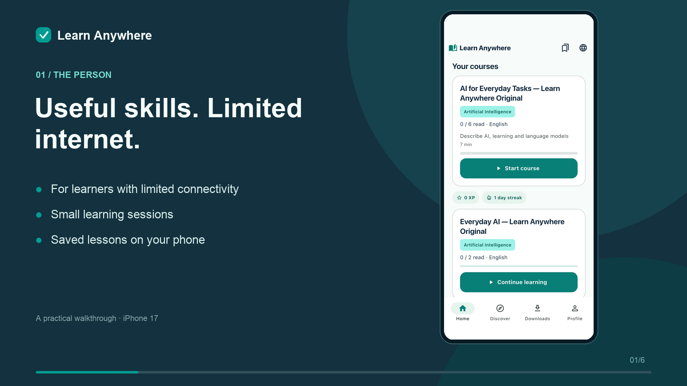](frontend/docs/demo/pitch/learn-anywhere-60-second-pitch.mp4)

[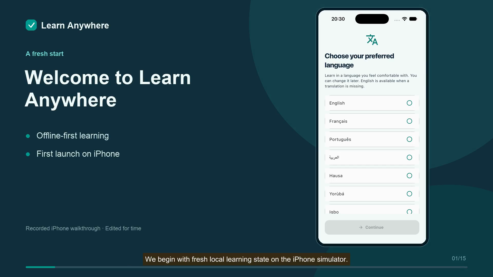](frontend/docs/demo/learn-anywhere-4-minute-explainer.mp4)

## User usage flow with screenshots

Choose a language → discover a course → save its lessons → read or listen → switch explanations when useful → take the final quiz → return to saved learning.

Screenshots show the running iPhone 17 Debug app captured on 13 October 2026. Click a compact screenshot to open its full-resolution image. The walkthrough shows quiz entry without submitting answers; it is not a network-disabled offline test or independent bilingual review.

### 1. Choose your language

On first launch, choose a language. Later, tap the globe in the toolbar, choose **English, Français, Português, العربية, Hausa, Yorùbá, or Igbo**, then tap **Apply languages**. A missing published lesson pack downloads before it is applied. Download while connected; saved lessons remain available offline. An unavailable translation produces a message instead of silently discarding your preference.

<a href="frontend/docs/screenshots/06-language-picker.png">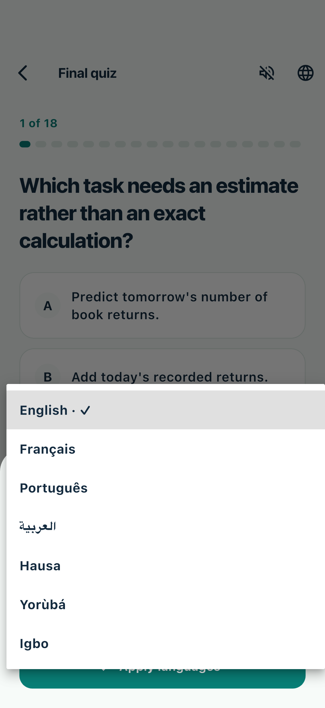</a>

### 2. Discover a course

Open **Discover**, search using **Find a course**, and tap **View course**. Pull down or tap **Refresh** to fetch newly published courses. Cards show a description, category, lesson count, and final quiz. Internet is needed to discover new content and download missing packs.

<a href="frontend/docs/screenshots/01-discover.png">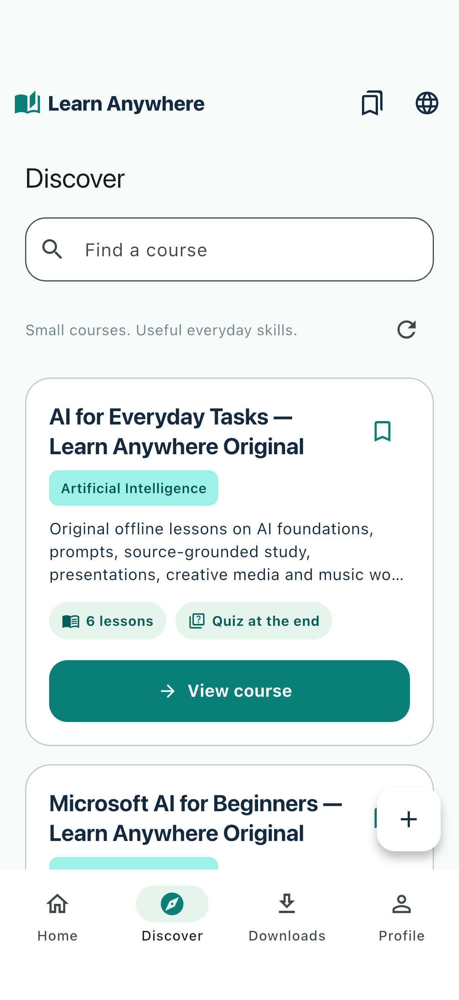</a>

### 3. Open the contents and save the course

Opening a course downloads its selected-language pack when needed. The contents page lists the lessons, their reading state, and languages saved on this device. Tap any lesson to begin. For a series, choose a part first. Lesson counts follow the material; this course has six lessons. Opening or skipping a lesson does not by itself mark it read or earn quiz points.

<a href="frontend/docs/screenshots/02-course-contents.png">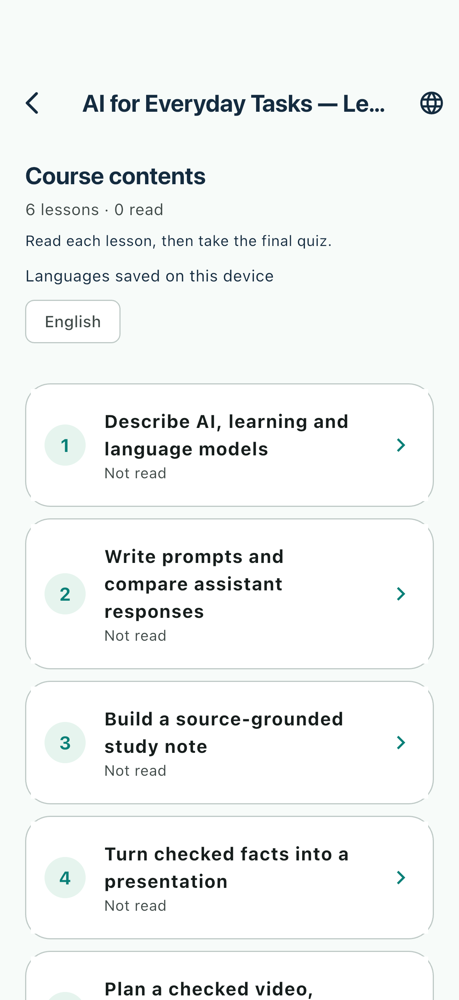</a>

### 4. Read, listen, or switch to an explanation

The lesson shows its reading estimate and **Ready offline** status. Read the text and complete its paper or notebook activities. **Read aloud** and the speed control use available iPhone voices; stop playback before leaving if needed. Use the bookmark icon to save a lesson for later. Source links appear in the dedicated further-reading card.

Tap the **teal lightbulb** to substitute a shorter explained version on the same page. **Explained version · 1** identifies the saved explanation version. Tap the button again to return to regular content. Both views use the same final assessment. Pages reopen at the top while keeping saved progress.

<a href="frontend/docs/screenshots/03-read-lesson.png">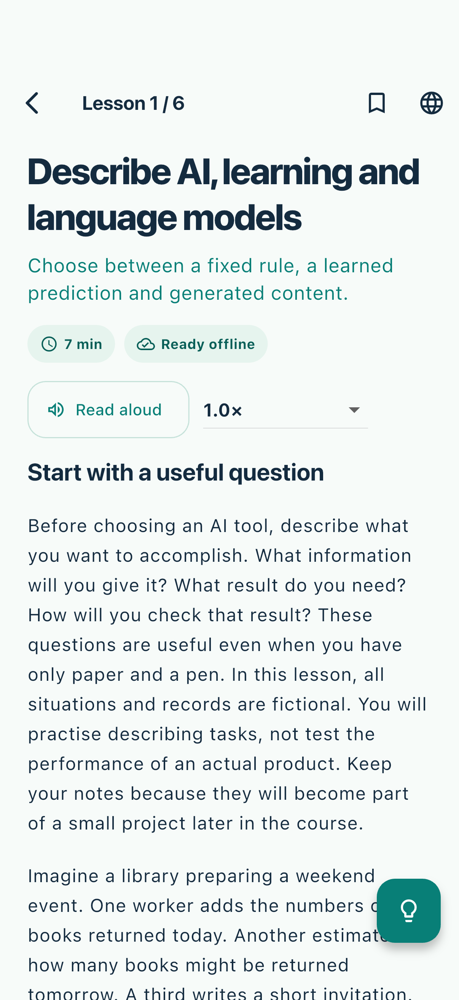</a>

<a href="frontend/docs/screenshots/04-explained-version.png">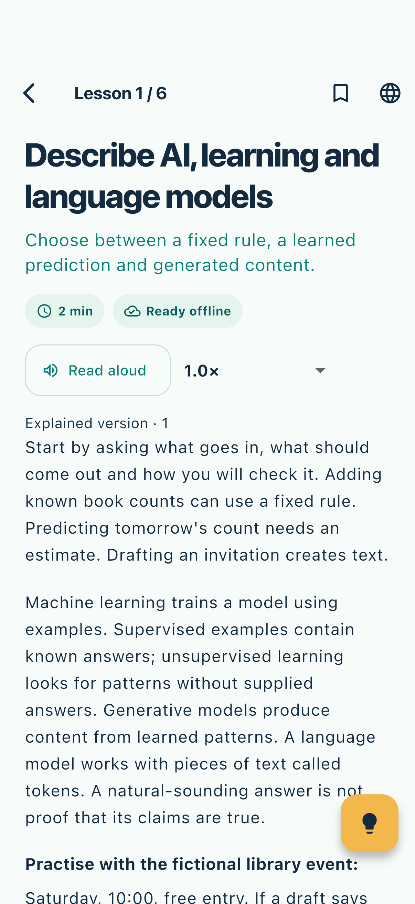</a>

### 5. Take the final quiz and apply the skill

Return to the contents page and tap **Take final quiz**. Choose an answer and use **Next question**. Answers save locally; correctness stays hidden during the assessment. Submit at the end to see the score, then use **Review answers** for correct answers and explanations. The captured screen shows question 1 of 18 before an answer is selected. After completing the assessment, follow the practical **Final challenge** instructions. Reading progress and quiz completion are separate.

<a href="frontend/docs/screenshots/05-final-quiz.png">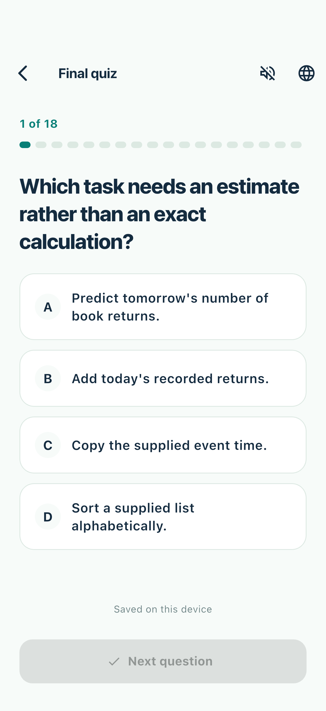</a>

### 6. Reopen saved courses offline

Open **Downloads** to see the device's saved course library. **Ready offline** confirms that a pack is saved. Tap **Open course** to return to its contents, or **Manage languages** to review available and saved languages. Saved languages remain available without another download; discovering new courses and fetching updates need a connection.

<a href="frontend/docs/screenshots/07-downloads.png">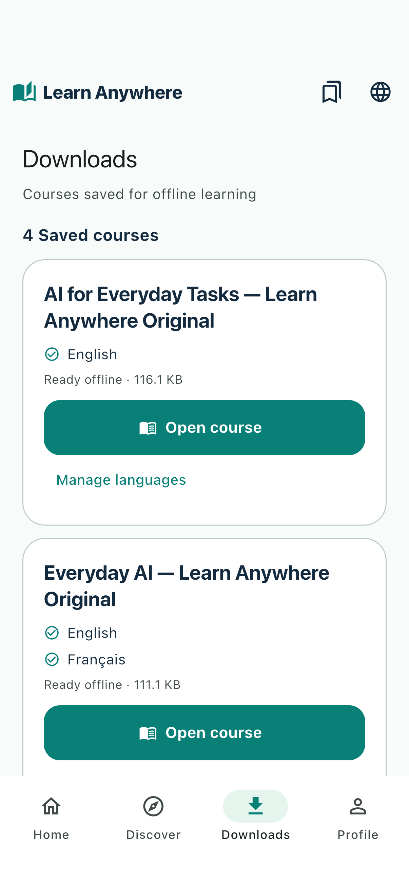</a>

### 7. Continue from Home

**Home** shows your saved courses and reading progress. Use **Start course** or **Continue learning** to resume. Progress, answers, bookmarks, and downloaded materials stay on the device between visits; pending learning activity synchronizes when the backend is reachable.

<a href="frontend/docs/screenshots/09-home.png">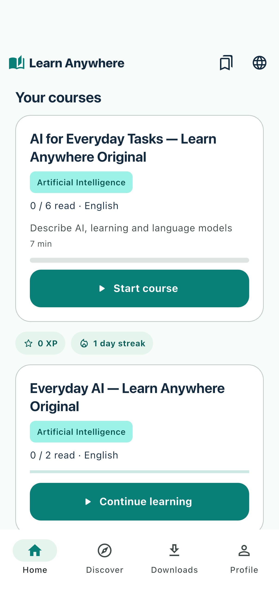</a>

### 8. Adjust your learning preferences

Open **Profile** for progress, badges, the final challenge, and **Settings**. Choose **Teal light** or **Teal dark**, adjust font size, and review the learning and accessibility controls. The optional learner profile can start lessons with explained content. Preferences persist on the device. Learners do not need an account or password to read downloaded courses.

<a href="frontend/docs/screenshots/08-profile.png">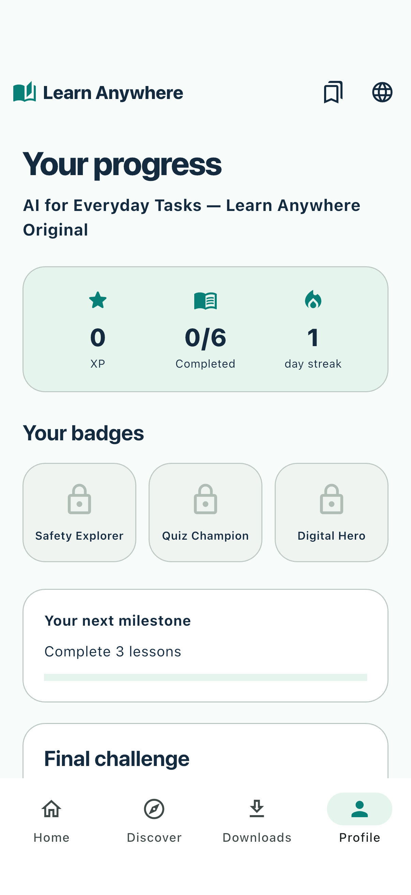</a>


## Architecture and repository

```text
e-learning-system/
├── frontend/                 Flutter app, native iOS integration, and tests
│   └── docs/                 Usage screenshots, demo videos, scripts, captions
├── backend/                  Quarkus API, Flyway migrations, and tests
│   └── content/published/    Archived published course packs and review records
└── docs/                     Shared content review and authoring guidance
```

Flutter stores downloaded packs, cached catalog data, preferences, progress, and pending events in SQLite. iOS installation tokens use Keychain. The API stores immutable content versions, installations, progress, event acknowledgments, and review records in PostgreSQL. The backend stores token hashes. Published content archives in this repository do not automatically seed the database; the app downloads content from the configured API.

See [backend architecture](backend/design/architecture.md) for service boundaries and [backend setup](backend/README.md) for API details.

### Database tables

The diagrams cover 13 PostgreSQL tables and four phone SQLite tables. Solid arrows show enforced foreign keys; dashed links show application relationships.

[Open the responsive diagram viewer](docs/database-diagram/index.html) · [Mermaid source and relationship notes](docs/database-diagram/tables.md)

**PostgreSQL content and publication**

[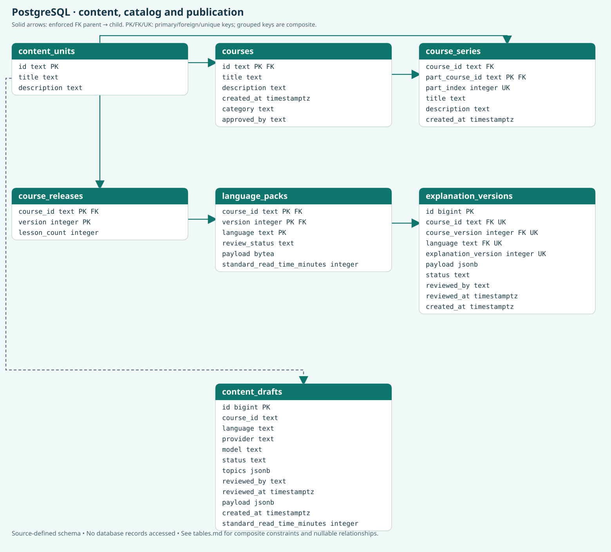](docs/database-diagram/postgres-content.svg)

**PostgreSQL activity and administration**

[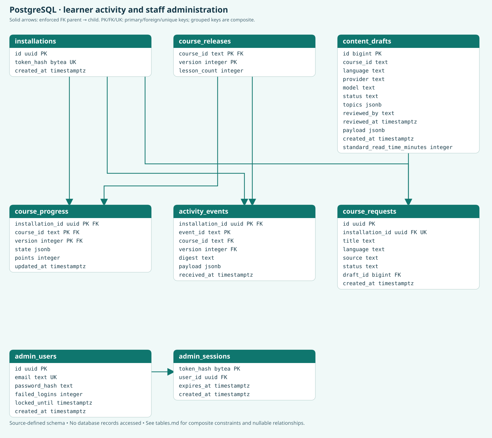](docs/database-diagram/postgres-activity.svg)

**Phone SQLite storage**

[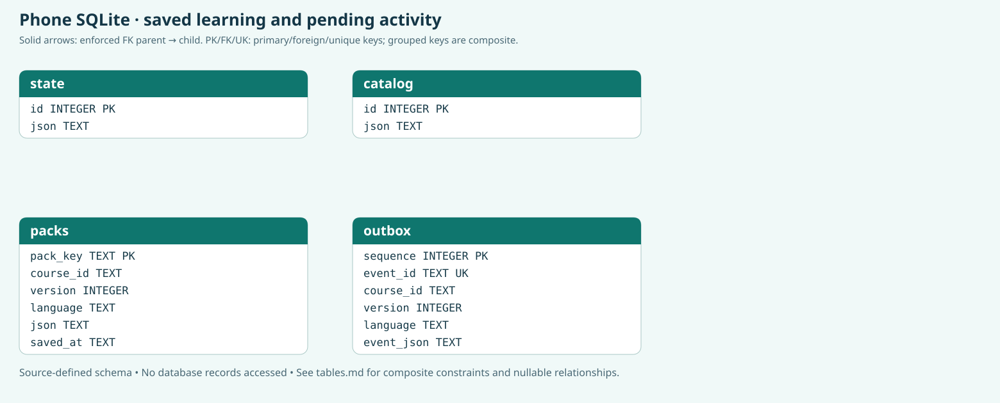](docs/database-diagram/phone-sqlite.svg)

Click a diagram to open its full-size SVG. Download the HTML viewer with its neighboring files to use the fit-to-page and full-size controls locally.

## Local development

### Requirements

- Flutter with Dart 3.10 or later.
- Java 17 or later and Maven; ensure Maven uses the supported JDK.
- Docker with Compose for PostgreSQL and the local API.
- macOS, Xcode, an installed iOS runtime or connected iPhone, and appropriate signing for iOS builds.

### Start the API

The supplied Compose file is for local development. It contains development database defaults and exposes the API on port 8084. Preserve existing environment secrets and the PostgreSQL volume when continuing a configured project.

```sh
cd backend
mvn package
docker compose -p learn-anywhere up -d --build
curl --fail http://127.0.0.1:8084/api/v1/health
```

For an IDE or `mvn quarkus:dev` workflow, use the environment configuration in [backend/README.md](backend/README.md). Optional provider keys belong only on the backend; they are not needed to read published packs.

| Local service | Address |
| --- | --- |
| API | `http://127.0.0.1:8084/api/v1` |
| Health | `http://127.0.0.1:8084/api/v1/health` |
| Swagger, when enabled | `http://127.0.0.1:8084/api/v1/swagger-ui/` |
| PostgreSQL | `localhost:5432`, database `learning` |
| Adminer | `http://127.0.0.1:8083` |

### Run the iPhone app

From the repository root:

```sh
cd frontend
flutter pub get
flutter devices
flutter run -d <ios-simulator-id> --dart-define=LEARNING_API_URL=http://127.0.0.1:8084
```

Swift Package Manager is enabled in `frontend/pubspec.yaml`. Regenerate iOS configuration after native dependency changes and verify that the generated plugin package includes SQLite.

For a physical iPhone on the same Wi-Fi, use the existing script with the connected device identifier:

```sh
bash scripts/run-ios.sh --debug --device <iPhone-ID>
bash scripts/run-ios.sh --release --device <iPhone-ID>
```

The script checks backend health and selects the Mac's Wi-Fi address. Set `LEARNING_API_URL` explicitly if needed. A phone needs a reachable address, local-network permission, and network access to the Mac. Loopback works for the simulator, not a separate phone. **Runner** is the Debug scheme; **Runner Release** is the physical-device Release scheme. A Debug simulator run is not a Release build or exported IPA.

## Production deployment

The repository provides application code and a local demo stack, not a complete production deployment. Use the following as deployment requirements rather than evidence that a production environment has been verified.

### Backend configuration

| Variable | Purpose |
| --- | --- |
| `APP_HOST`, `APP_PORT` | API listener address and port. |
| `JDBC_DATABASE_URL` | Connection to the deployment's PostgreSQL database. |
| `POSTGRES_USER`, `POSTGRES_PASSWORD` | Database credentials supplied through secret management. |
| `DB_MAX_OPEN` | JDBC connection pool limit; default is 10. |
| `MIGRATE_AT_START` | Enables Flyway migration at startup; review migrations and take a recoverable backup first. |
| `ADMIN_TOKEN` | Bootstrap credential for creating an administrator through first login; not a normal admin session. |
| `SWAGGER_ENABLED` | Build-time Swagger UI inclusion; default is disabled in packaged builds. |
| `OPENAI_API_KEY`, `OPENAI_MODEL` | Optional content-generation provider configuration. |
| `GROQ_API_KEY`, `GROQ_MODEL` | Optional learning-companion provider configuration. |

Build with a supported JDK using `mvn clean install`. Package the generated `target/quarkus-app/` directory with the existing Dockerfile or the documented Java launch command. Use a separate deployment configuration with strong database credentials; the local Compose file's development password is not suitable for production. Keep PostgreSQL and administrative database tools off public interfaces. Publish the API through HTTPS, protect admin access, configure monitoring, and manage secrets outside source control.

Administrator login sessions are implemented, with hashed passwords, expiring session tokens, and account lockout. Production identity operations still need review: password recovery, email verification, account lifecycle management, and distributed abuse protection are not provided.

### Mobile distribution

Before preparing a public iOS release:

1. Replace the local-demo settings in `frontend/ios/Flutter/Release.xcconfig`. Remove its hard-coded private HTTP endpoint and `ALLOW_LOCAL_DEMO_HTTP=true` opt-in.
2. Configure `LEARNING_API_URL` to the deployment's HTTPS API origin. Do not include provider keys, admin credentials, or reset flags in the app.
3. Validate the release against that backend, including downloads, language changes, offline reopen, pending-event sync, and the available native features.
4. Build and sign the Release app using the intended distribution profile. Verify installation and launch separately from build success; export an IPA only when needed and signing permits it.

Local-demo HTTP settings permit private IPv4 addresses for the authorized demo. They do not establish public HTTPS readiness. No App Store submission or production deployment is performed by these instructions.

## Operations and data

- **Availability:** monitor the health endpoint and a published catalog/pack request. An API health response alone does not prove phone connectivity or successful content delivery.
- **Durability:** maintain PostgreSQL backups and test restoration in an isolated environment. Preserve the `learning_pg` volume; do not use volume deletion or reseeding as routine recovery.
- **Migrations:** add versioned Flyway migrations, review compatibility, and back up before applying changes. Do not edit already-applied migration history.
- **Sync:** retain pending event IDs until acknowledged. Preserve event digest checks, transaction boundaries, and stable course, lesson, question, and option identities across translations.
- **Privacy:** optional learner profile and coaching preferences remain on-device. Keep credentials, installation tokens, personal data, and database exports out of commits and screenshots. Define retention, recovery, and incident procedures for the deployment.
- **Content:** publish reviewed material using new immutable versions; preserve previously downloaded versions and progress compatibility.

Refer to [SECURITY.md](SECURITY.md) for reporting and handling sensitive information. Local Wi-Fi sharing transfers content, not learner accounts or progress. It uses paired private-network HTTP with a session code and a 25 MB bundle limit; hosted media and automatic nearby discovery are not implemented.

## Content publishing

Generated lessons and translations start as drafts and require explicit approval. Owner approval is recorded separately from factual accuracy and independent bilingual review. Course lesson counts follow the material; current authoring policy requires substantive 5–15 minute lessons, excluding quizzes and practice.

The normal workflow is administrator login → import draft → inspect and review → approve → verify public catalog and language downloads. `ADMIN_TOKEN` authorizes first-login account creation; subsequent admin operations use the returned bearer session. Reviewed explanations can have their own approved version tied to an immutable course/version/language pack. Fetching reviewed explanations does not call an AI provider.

| Endpoint | Purpose |
| --- | --- |
| `GET /api/v1/courses` | Published standalone courses and ordered series parts. |
| `GET /api/v1/packs/{course}/{language}?version=N` | Versioned pack download with ETag support. |
| `GET /api/v1/explanations/{course}/{language}?version=N` | Latest approved explained version for that pack, when available. |
| `POST /api/v1/installations` | Anonymous installation and token creation. |
| `POST /api/v1/progress/sync` | Idempotent progress synchronization. |
| `POST /api/v1/admin/auth/login` | Administrator login or authorized first-login creation. |
| `POST /api/v1/admin/drafts` | Draft import using an administrator session. |
| `POST /api/v1/admin/drafts/{id}/approve` | Explicit draft approval and publication. |

Download and synchronize series content using the part ID. A parent's combined language list does not establish translation availability for every part. New installations have no bundled demo courses. See [content review](docs/content-review.md), the [authoring prompt](backend/docs/topic-to-course-prompt.md), and [published content records](backend/content/published/).

## Validation

```sh
cd frontend
flutter analyze
flutter test test/ui_test.dart test/store_test.dart test/markdown_test.dart
cd ../backend
mvn clean install
```

Tests that require a live service must use the current published catalog and preserve learner data. For release validation, also check the selected iPhone's launch and visible UI, native speech and accessibility where available, HTTPS connectivity, language downloads, offline reopen, and synchronization. Report checks actually executed; a build, screenshot, or owner-approved demo does not establish production readiness.

The committed videos include [four-minute export checks](frontend/docs/demo/verification.json) and [pitch export checks](frontend/docs/demo/pitch/verification.json). The [screenshot record](frontend/docs/screenshots/capture-record.json) describes capture scope and limitations.

## Limitations and project documentation

The current learner experience is text-first. In-app hosted video/slides, Android native speech, automatic nearby discovery, learner cross-device account recovery, and high-stakes assessment protections are not completed. Course-reading notifications and companion reminder actions are Debug-only; Release/Profile hides them and blocks scheduling. Supplementary provider-backed AI output may be inaccurate, requires configured backend credentials and connectivity, and is separate from reviewed offline explanations. Ask ChatGPT was removed from the app.

Machine-translated course packs have owner approval, but independent bilingual expert review remains pending. Some dynamic catalog metadata and fallback messages may remain in English. Further production work includes translation review, operational hardening, and user testing.

| Document | Scope |
| --- | --- |
| [Contributing](CONTRIBUTING.md) | Development and validation workflow. |
| [Security](SECURITY.md) | Sensitive information and reporting guidance. |
| [Backend README](backend/README.md) | Backend setup, authentication, APIs, and database behavior. |
| [Architecture](backend/design/architecture.md) | Backend service boundaries and persistence. |
| [Content review](docs/content-review.md) | Draft review and publication approval. |
| [Project guide](AGENTS.md) | Shared agent instructions. |
| [Frontend guide](frontend/AGENTS.md) | App behavior and iOS release workflow. |
| [Backend guide](backend/AGENTS.md) | Backend conventions, migrations, and release checks. |
