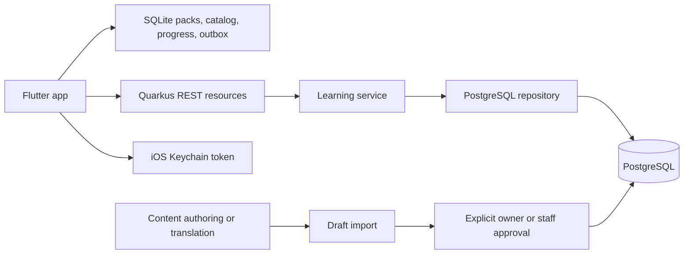

# Learn Anywhere architecture

## Application layers

For the local Wi-Fi demo, Docker publishes API port 8084 on the Mac's network interfaces. PostgreSQL and Adminer retain localhost-only host bindings. Host dev mode binds all interfaces unless APP_HOST overrides it. The physical mobile app must use the Mac's reachable Wi-Fi address; the Flutter launch script resolves it at launch and supports Debug or Release. Same-network membership alone does not bypass firewall rules or wireless client isolation.

Flutter downloads published course packs over HTTP and reads them locally. Quarkus resources depend on `ILearningService`, services on `ILearningRepository`, and the repository uses PostgreSQL. CDI wires implementations. `IContentGenerator` is a future content-provider extension point; generation and translation currently enter through reviewed draft imports.

## Course and series storage

`courses.approved_by` is optional catalog approver metadata added by migration V7. The three external AI course records are marked `AI` at the owner's request; this field does not publish content or replace `content_drafts.reviewed_by` and `reviewed_at`.

Flyway migrations preserve content identities while separating discovery structure:

1. `V1__initial.sql` creates course releases, language packs, installations, progress, events, and drafts.
2. `V2__course_series.sql` adds Understanding AI's parent and ordered part relationships.
3. `V3__move_parts_into_series.sql` moves top-level courses into a dedicated `courses` table, retains original identities in `content_units`, and gives `course_series` ownership of part titles and descriptions.

| Table | Purpose |
|---|---|
| `courses` | Top-level course metadata; currently AI Foundations and Understanding AI |
| `course_series` | Ordered part records: parent `course_id`, stable `part_course_id`, `part_index`, title, description |
| `content_units` | Stable content IDs referenced by releases; includes standalone courses, parts, and parent identities |
| `course_releases` | Immutable content release versions and lesson counts |
| `language_packs` | Published payloads keyed by content ID, version, and language |
| `content_drafts` | Generated or translated payloads and approval history |
| `installations` | Anonymous identity and hashed token |
| `course_progress` | Confirmed per-installation, per-content-version progress and points |
| `activity_events` | Idempotent activity IDs, payloads, and digests |

`courses.id` references `content_units.id`. A series part belongs to one parent; its index is positive and unique within that course. Pack/progress references retain their original IDs, so migrating weekly records does not reset learning progress.

The catalog returns `type: course` for a standalone pack-bearing course and `type: series` with ordered `parts` for a series. Understanding AI appears once, with 16 parts. Download and sync requests use the part ID. The API currently has no endpoint for creating or reordering series; migrations establish those relationships.

## Language and startup

Startup displays the Learn Anywhere logo, then asks new learners for one preferred language. The preference and onboarding completion persist locally. English, French, Portuguese, Arabic, Hausa, Yorùbá, and Igbo are supported.

One preference drives app labels and content selection. App labels are bundled for offline use; Arabic has right-to-left layouts. Some dynamic catalog metadata or supporting copy may remain English. If a preferred pack is unavailable, the learner retains the preference while using an available pack. Applying an available language shows a spinner while downloading and switches after the pack is saved.

Understanding AI has 112 published packs representing 80 lessons in seven languages. Source links and question identities/order remain stable across languages. The six machine-translated versions have local-demo owner approval; expert bilingual certification is outstanding.

## Reading, assessment, and progress

Each course or part has a material-dependent number of lessons and one final assessment. Learners may skip chapters and is highlighted separately from quiz completion. Series cards show partial read counts or Read when all lessons are read.

The assessment saves each answer without revealing correctness or reward changes. The final screen shows the total score. A separate answer-review screen shows selected answers, correct answers, and explanations. Internally, assessment events still use each lesson's question IDs and completion groups, retaining compatibility with existing progress and reward keys.

Flutter stores packs, catalog data, snapshots, and pending events in SQLite. Tokens use iOS Keychain. Backend batches are transactional and retries idempotent. Confirmed rewards cannot be duplicated through quiz practice. A practical task requires assessment completion and its checklist.

## Credibility and operating limits

Draft import validates structure and HTTPS attribution; it does not prove accuracy. Explicit approval precedes publication. Original source links remain visible in the reader. Translation alone does not localize curricula, credentials, institutions, or opportunities; these require verified country-specific work.

Current lessons use text. Backend schemas accept slides and video metadata, but Flutter media viewers and hosted delivery remain future work. The prototype also lacks cross-device restore, production staff authentication, and secure high-stakes assessment.

## Local services and checks

- Current API and Swagger: `http://127.0.0.1:8084`.
- PostgreSQL: `localhost:5432`, database `learning`.
- Adminer: `http://127.0.0.1:8083`.
- An older server on port 8082 may still be running.

Seven backend tests and 13 focused Flutter tests pass. Live checks verified the migrated top-level course/series structure and all Understanding AI language-pack downloads. See [backend README](../README.md) and [project README](../../README.md) for run instructions.

## Transaction guarantees

All application routes use `/api/v1`, including health, catalog, packs, installation, sync, drafts, and approval. Swagger and OpenAPI also use this namespace. Old unversioned application routes are removed; clients must use the new paths. Quarkus development tooling remains framework-managed.

Every repository operation uses an explicit PostgreSQL transaction. Responses return only after commit; failures roll back the complete operation. Transactions set `synchronous_commit=on` for WAL durability. Foreign keys and unique constraints enforce consistency. Synchronization locks the installation row, checks event digests, and commits events, rewards, and progress together. Publication locks the draft and a transaction-scoped course/version advisory lock before comparing translations, preventing concurrent first publications from bypassing structural validation. Pack insertion and approval history commit together.

These guarantees cover PostgreSQL operations. They do not make network delivery atomic with a database commit: clients must retry using stable event IDs. Installation registration and draft creation do not yet accept idempotency keys. Durability also depends on PostgreSQL storage and backup configuration; high availability and disaster recovery remain deployment responsibilities.

Catalog entries expose `created_at` as a UTC timestamp and are ordered newest first, with ID as a stable tie-breaker. Series parts remain ordered by `partIndex`. Migration V4 adds timestamps without resetting records; historical records use the earliest available approved-draft timestamp, or the migration time when history is unavailable. New courses use their insertion time.

The optional learning companion resource delegates to `ILearningCompanion`/`LearningCompanion`. Installation authentication uses the existing repository; published pack access uses `ILearningService`. The service strips assessment questions and personal state before calling Groq Chat Completions. Replies are supplemental help and never enter the publishing pipeline. Local Flutter state holds the response cache, and native local notifications choose from explicitly saved reminder messages. There is no learner profiling database migration or transmission of reading history. Provider key and companion model configuration remain server-side.

Reviewed explanation downloads: published course packs may include `explanations: {version: 1, lessons: [{id: 0, text: "..."}, ...]}` with one explanation for every actual lesson, in matching order. `GET /api/v1/explanations/{course}/{language}?version=N` returns `available`, course identity, and (when available) `explanationVersion` and lesson texts. This endpoint never calls AI. Explanations follow the existing draft review/approval process; changing published explanations requires a new immutable course version. Flutter downloads the whole explanation pack, saves it in device state, displays its version, and supports offline reading and checking for updates. Existing courses without explanations return `available:false`; no generated content has been published automatically.

Reading duration is language/version-specific. Migration V8 adds generated `standard_read_time_minutes` columns to drafts and language packs, calculated from actual JSON lesson-body words at 200 words/minute with per-lesson rounding. Published byte payloads and draft approval states remain unchanged. These course totals are estimates and are not capped at the per-lesson 5–15-minute authoring range.

### Administrator authentication

AuthResource → IAuthService → IAuthRepository separates HTTP, credential rules and PostgreSQL transactions. IPasswordHasher encapsulates salted PBKDF2 verification. V9 adds admin_users and hashed expiring admin_sessions; mobile installations/progress remain independent. Existing draft service authorization validates an administrator session. ADMIN_TOKEN authorizes first-login account creation only. Account-level failure counters commit before returning rejected login status.

Explanation versions are separate reviewed records with a foreign key to the exact language pack. Approval is independent of course release; drafts are never returned to learners. Existing embedded explanation packs remain compatible.
