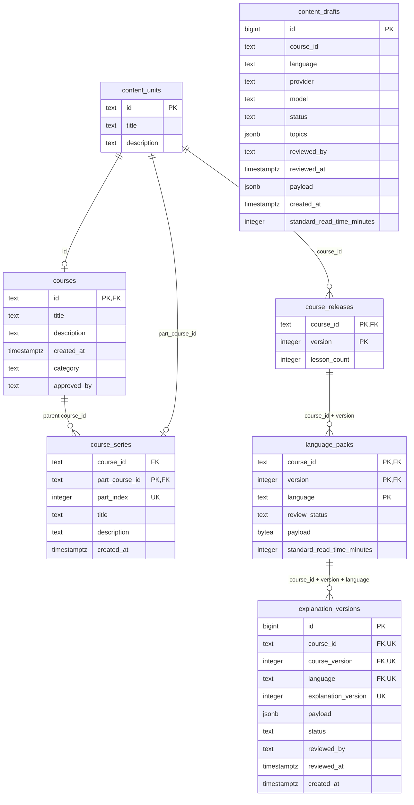
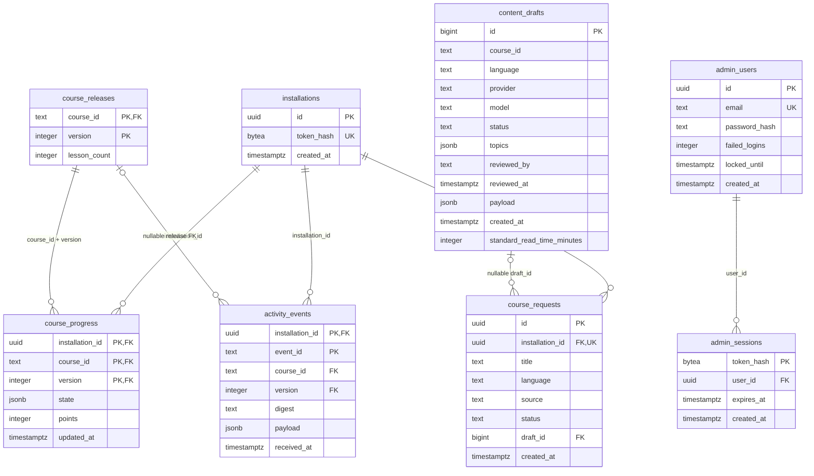
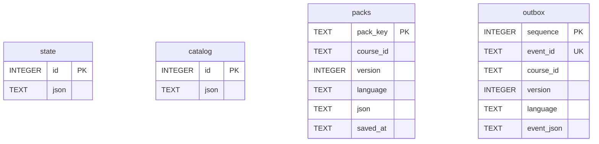

# Learn Anywhere database tables

Verified against Flyway migrations V1–V10 and the current Flutter SQLite creation statements. This is the schema defined by source, not an inspection of a running database. No records or credentials were read.

## PostgreSQL content and publication

## PostgreSQL activity and administration

## Key and relationship notes

- Solid relationships are declared foreign keys. `content_drafts.course_id` logically identifies `content_units.id`, but has **no enforced foreign key**. Drafts can precede creation of catalog records.
- V3 renames the original `courses` table to `content_units`; existing release and part foreign keys therefore point to `content_units`, not the new root catalog table.
- Composite primary keys: releases `(course_id, version)`; packs `(course_id, version, language)`; progress `(installation_id, course_id, version)`; events `(installation_id, event_id)`. Composite foreign keys use these same release/pack identities.
- Unique groups: series `(course_id, part_index)`; explanations `(course_id, course_version, language, explanation_version)`; requests `(installation_id, id)` (redundant with its globally unique primary key). UK markers within these groups do not mean each column is individually unique.
- `activity_events.course_id` and `version` are nullable in the migration; the release relationship is optional. `course_requests.draft_id` is nullable.
- Installation deletion cascades to progress and events; requests do not specify a delete cascade. Admin user deletion cascades to sessions.
- Lessons, questions, answers and explained lesson bodies are inside pack payloads rather than separate PostgreSQL lesson tables. Explanation versions reference a particular published language pack. `approved_by` is catalog metadata, not a publication action.
- Reading estimates in drafts and packs are generated stored columns, calculated from lesson-body words.

## Phone SQLite (separate database)

SQLite schema version 3 declares no foreign keys between these four tables. JSON state holds preferences and local progress; packs hold saved learning content; catalog caches discovery metadata; outbox retains activity awaiting acknowledgment. Pack identity and event payloads provide application-level links to backend content. Installation tokens are stored in platform secure storage, not a SQLite token table.

## Verification sources

- `backend/src/main/resources/db/migration/V1__initial.sql` through `V10__explanation_versions.sql` (all ten migrations read).
- `frontend/lib/store.dart`: current onCreate statements around lines 485–516 and pack/outbox schemas around lines 1452–1456.
- Root, backend and frontend `AGENTS.md`; architecture notes used as background, migrations used as authority.
